# Social Habits: La Città Intorno

_Lacittàintorno_ is a programme for urban regeneration promoted by Fondazione Cariplo

- Designed to foster well-being and quality of life in urban areas
- Enhancing the functions and services in place in the following target neighbourhoods: Adriano, Via Padova, Corvetto, and Chiaravalle
- 10 million euros investment over a three-year timeframe

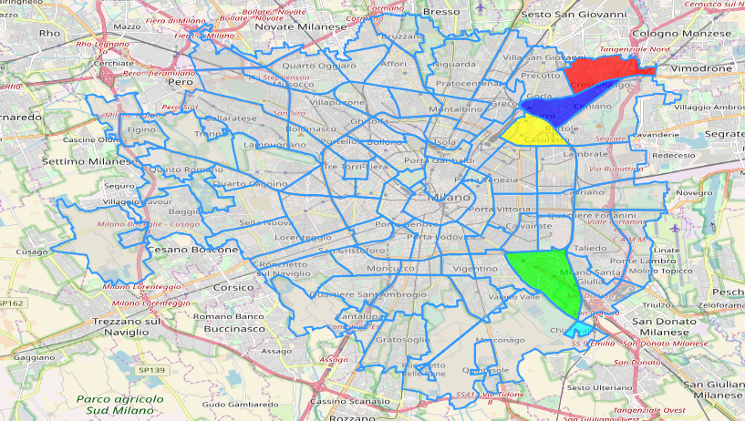

**Question**: what is the profile of users in these neighborhoods?

# Location Intelligence and Mobility Data

::::{.columns}
::: {.column width="75%"}

_More than 80% of companies_ take decisions on the basis of information characterized by a spatial component.

* **Geo-referenced data**: are data that contain a spatial position, they are typically static
* **Trajectory data**: describe objects moving in the environment
* The main providers of trajectory data are:
    * Apps collecting data from GPS
    * Telco that trace connection to Base Transceiver Stations
    * Fleets of trucks, cars and ships
    * ...

_Location Intelligence_ is a set of tools that allow  __a geographic dimension__ to be integrated within a  __BI platform__.

- The goal is to increase the  __monitoring ability__ and the capability of understanding  __business events__.
- Location intelligence supports  __data visualization and interaction with maps__ in  __BI contexts__.

:::
::: {.column width="15%"}

:::
::::

# Google Timeline

::::{.columns}
::: {.column width="50%"}
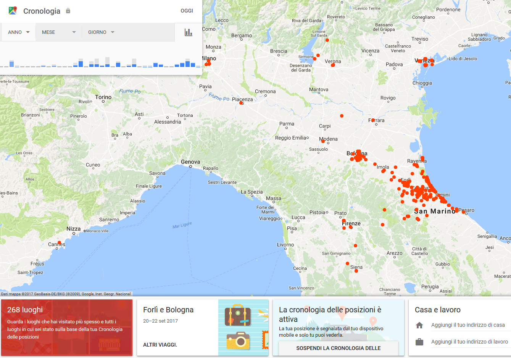
:::
::: {.column width="50%"}
:::{.fragment}
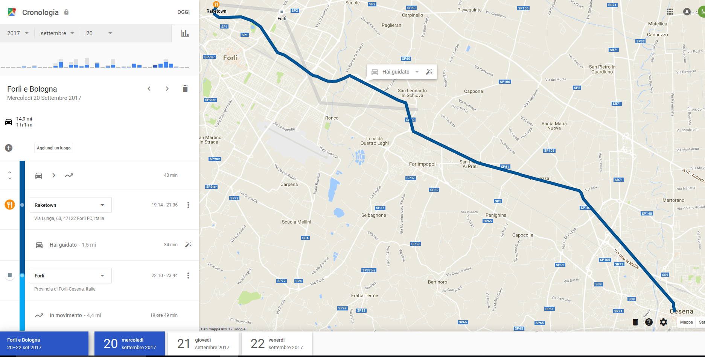
:::
:::
::::

# Open Street Map

::::{.columns}
::: {.column width="50%"}
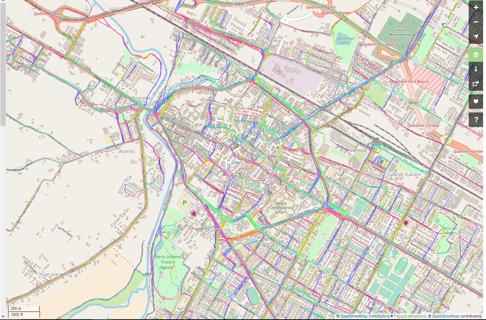
:::
::: {.column width="50%"}
:::{.fragment}
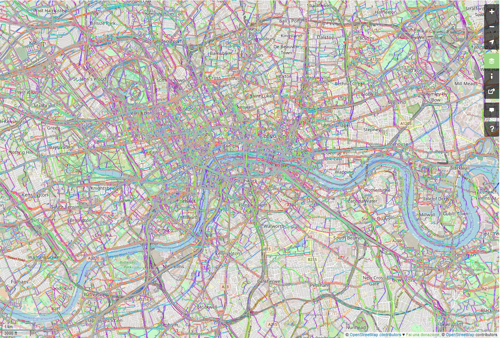
:::
:::
::::

# How do you identify relevant places?

::::{.columns}
::: {.column width="50%"}
**Personal gazetteer** is a personalized, digital record of significant locations (stay points) to an individual, similar to a geographical fingerprint

- *Staypoints* are places of interest for a user
- How can extract staypoints with the following semantics?
    - *Frequented* places?
    - *Home*?
    - *Work*?
:::
::: {.column width="50%"}
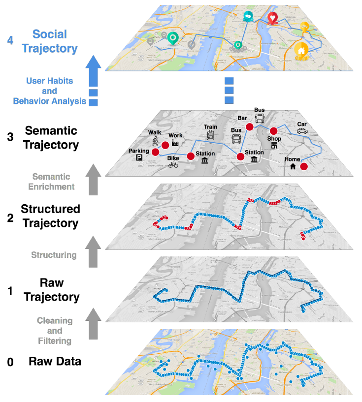
:::
::::

# How do you identify relevant places?

::::{.columns}
::: {.column width="50%"}

Staypoints vs Trajectories

* **Trajectories** describe mobility behaviors/patterns
  * USE CASE: understand where people going to an event come from?
  * *Frequent trajectories*: an end-to-end cluster of trajectories that are:
    * Compact enough
    * Frequent enough
    * Long enough
* **Staypoints** identify places of interest for a user
    - *Home*: the place where a user frequently stops between 1 and 5
    - *Work*: the place where a user frequently stops between 9 and 17
    - *Attend*: a place where the user stands at least 20 minutes and where at least one commercial activity is situated

:::
::: {.column width="50%"}
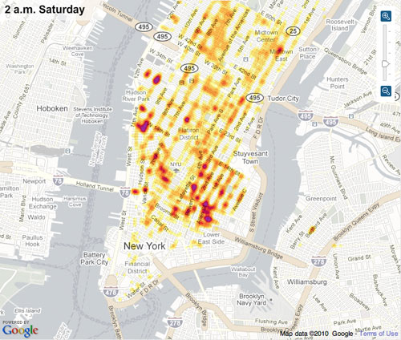
:::
::::

# Social Habits: LiveIn vs WorksIn

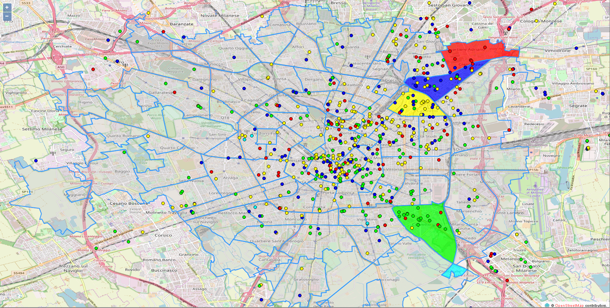

# Social Habits: LiveIn vs Attend {visibility="hidden"}

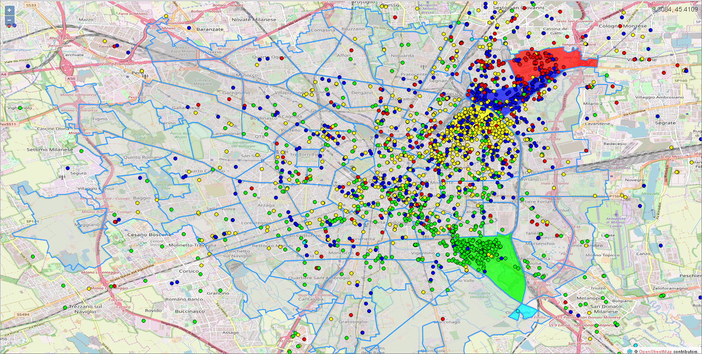

# Social Habits: LivesIn Adriano vs WorksIn *

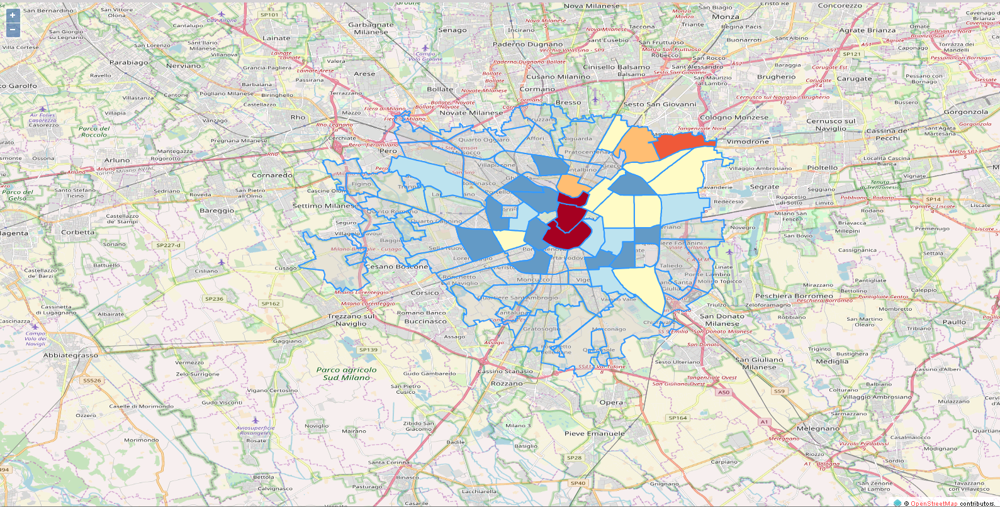

# Social Habits: LivesIn * vs WorksIn Adriano

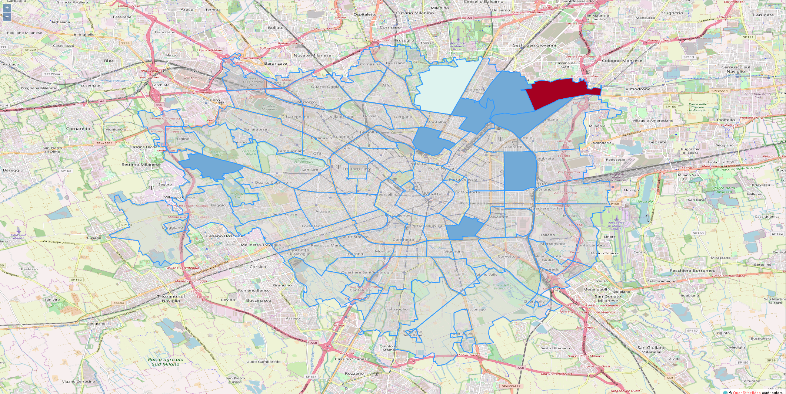

# Visitor-to-resident ratio and neighborhood reach [@DBLP:journals/eswa/FranciaGG24]

The previous figures provide *qualitative* results. How can we *quantitatively* measure attractiveness?

:::{.fragment}

- $\text{Visitor-to-resident ratio}(n) = \frac{WorkIn_n + Frequent_n}{LiveIn_n}$
- $\text{Neighborhood reach}(n) = \frac{|\{p \in \mathcal{P} : p \text{ passes through } n\}|}{|\mathcal{P}|} \times 100\%$
  - Neighborhood reach is the percentage of co-movement patterns passing through neighborhood $n$.
  - A pattern can pass through multiple neighborhoods, so percentages need not sum to 100% across neighborhoods.
  - $\mathcal{P}$ is the set of all co-movement patterns.

:::

:::{.fragment}

|Neighborhood           | Distinct users  | WorkIn + Frequent | LiveIn  | Visitor-to-resident ratio  |Neighborhood reach|
|-----------------------|-----------------|-------------------|---------|-------------------|-----------------|
|Brera                  | 2779            | 2396              | 440     | 545%              | 83%             |
|Duomo                  | 4607            | 4203              | 464     | 906%              | 83%             |
|Buenos Aires - Venezia | 3840            | 2644              | 1484    | 178%              | 82%             |
|XXII Marzo             | 1790            | 1202              | 681     | 177%              | 82%             |
|...                    | ...             | ...               | ...     | ...               |...              |
|Gallaratese            | 1508            | 929               | 752     | 124%              | 5%              |
|Lodi - Corvetto        | 1627            | 993               | 795     | 125%              | 4%              |
|Padova                 | 1628            | 996               | 753     | 132%              | 3%              |
|Adriano                | 636             | 316               | 385     | 82%               | 1%              |

:::

# Discussion: explainability in mobility data

> The dashboard labels someone as a resident and ranks one neighborhood as more attractive than another. How would you explain those results?

- Which observations led to the **home** label? How much evidence was required?
- How would results change with a different nighttime window or minimum stay duration?
- Does a high **visitor-to-resident ratio** reflect many visitors, few residents, or both?
- Are *attractiveness* and *visiting frequency* interchangeable?
- How should uncertain labels and incomplete coverage appear in the dashboard?

# Discussion: fairness in mobility data

> A neighborhood has fewer observed visits. Should it receive less investment?

- **Coverage:** who might be missing from the dataset? Consider children, older people, and people without the tracked apps.
- **Measurement:** does low recorded activity mean low activity, or low data coverage?
- **Inference:** who is misclassified by "home between 1-5" and "work between 9-17"? Consider night workers, remote workers, and people with multiple jobs.
- **Consequences:** what additional evidence would you require before using these results to allocate public resources?

# Discussion: privacy in mobility data

> We remove names and replace user IDs with random identifiers. Can we safely publish the trajectories?

- Could someone recognize a person from their home and workplace?
- What might visits to a clinic, place of worship, or political meeting reveal?
- For neighborhood monitoring, do we need individual trajectories, or would aggregate counts suffice?
- What do we lose by using larger spatial cells, weekly summaries, or noisy counts?

In a dataset of **1.5 million mobile-phone users**, **four randomly selected space–time points** uniquely characterized **95% of mobility traces**, at hourly and cell-tower spatial resolution [@demontjoye2013unique].

- Uniqueness enables linkage; it does not by itself attach a person's name to a trace.

# Mobility privacy in the news: Strava

| Case | Reported disclosure |
| --- | --- |
| **Military bases (2018)** | Strava's aggregate activity heatmap highlighted military sites and exercise routes, especially where surrounding civilian activity was sparse. [Le Monde](https://www.lemonde.fr/pixels/article/2018/01/29/la-securite-des-bases-militaires-menacee-par-une-application-de-jogging_5248885_4408996.html) |
| **French submarine patrols (reported 2025)** | *Le Monde* inferred likely patrol periods from public workouts at Île Longue and synchronized gaps in crew members' activity. This did not reveal submarines' positions at sea. [Le Monde](https://www.lemonde.fr/en/videos/article/2025/01/13/stravaleaks-dates-of-french-nuclear-submarine-patrols-revealed-by-careless-crew-members_6737005_108.html) |
| **French aircraft carrier (March 2026)** | AP reported that *Le Monde* located the *Charles de Gaulle* using a naval officer's public run and same-day satellite imagery. The deployment itself was already public. [AP](https://apnews.com/article/acbd3595a2317c2b8068dc42082c3d51) |

> Can the *absence* of activity reveal something too?

# Mobility privacy in the news: sensitive inferences

The Federal Trade Commission (FTC) is an independent agency of the United States federal government that enforces consumer protection and antitrust laws.

| Case | Alleged practice or documented risk |
| --- | --- |
| **Religion:** | Sale of audience segments based on inferred religious beliefs. It described geofencing churches and sharing device IDs, visit dates, and attendance frequency with a customer. [FTC complaint, §53 and §79](https://www.ftc.gov/system/files/ftc_gov/pdf/2123035gravyanalyticscomplaint.pdf) |
| **Health** | Sale of precise location data that could track visits to medical and reproductive health clinics. [FTC](https://www.ftc.gov/news-events/news/press-releases/2024/04/ftc-finalizes-order-x-mode-successor-outlogic-prohibiting-it-sharing-or-selling-sensitive-location) |
| **Protests: Mobilewalla (2020 report; 2024 complaint)** | Profile George Floyd protesters in June 2020, including inferred racial backgrounds and whether they lived locally. [FTC](https://www.ftc.gov/news-events/news/press-releases/2024/12/ftc-takes-action-against-mobilewalla-collecting-selling-sensitive-location-data) |

# Exploitation of Trajectory Data

::::{.columns}
::: {.column width="50%"}
* **Social habits and behaviors**
  * Identify relevant places
  * Identify communities
* **Urban mobility optimization**
  * Historical analysis of traffic flows
  * Early identification of accidents
  * Dynamic and real-time traffic management
  * Car pooling
- **Mobility/Movement mining** identification of the mode of transport \(car/foot\) along a trajectory
- **Reverse geocoding** it is the process by which an address or the name of a place is associated with a spatial datum \(latitude, longitude\)
- **Layer integration** it is the process by which several information layers are superimposed and interrogated
* **Proximity marketing \(indoor\)**
* ... and many others
:::
::: {.column width="50%"}

:::
::::

# Exploitation of Trajectory Data: Proximity marketing

::::{.columns}
::: {.column width="50%"}
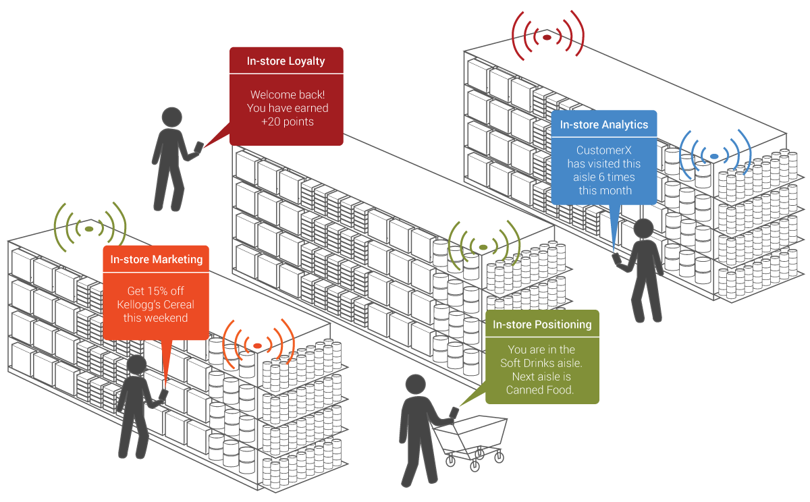
:::
::: {.column width="50%"}

:::
::::

# Exploitation of Trajectory Data: Urban mobility optimization: traffic flows

**Flow**: is defined by a sequence of overlapping trajectories that are not necessarily end-to-end compact

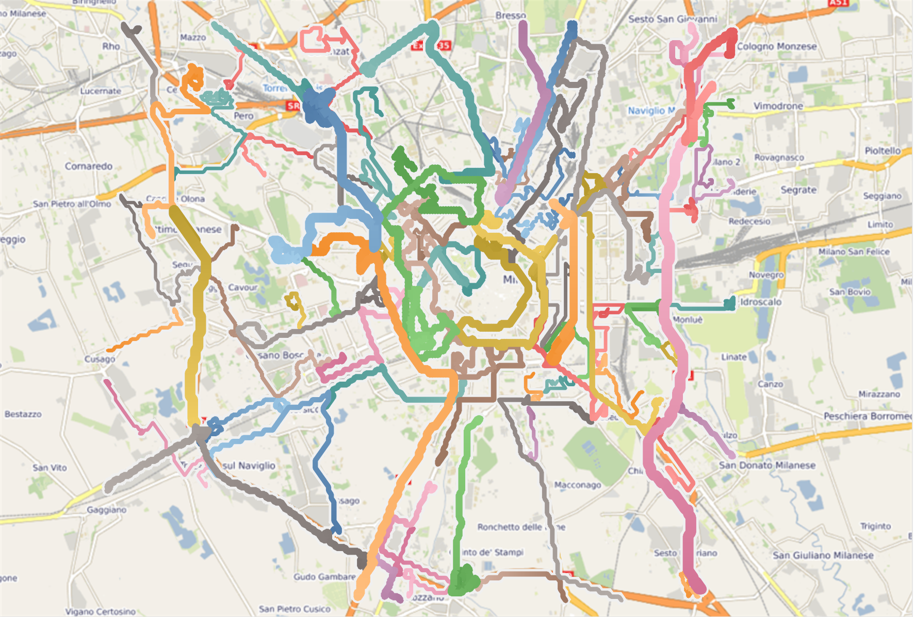

# Exploitation of Trajectory Data: Urban mobility optimization: traffic flows

**Flow**: is defined by a sequence of overlapping trajectories that are not necessarily end-to-end compact

USE CASE: identify crowded routes

::::{.columns}
::: {.column width="50%"}
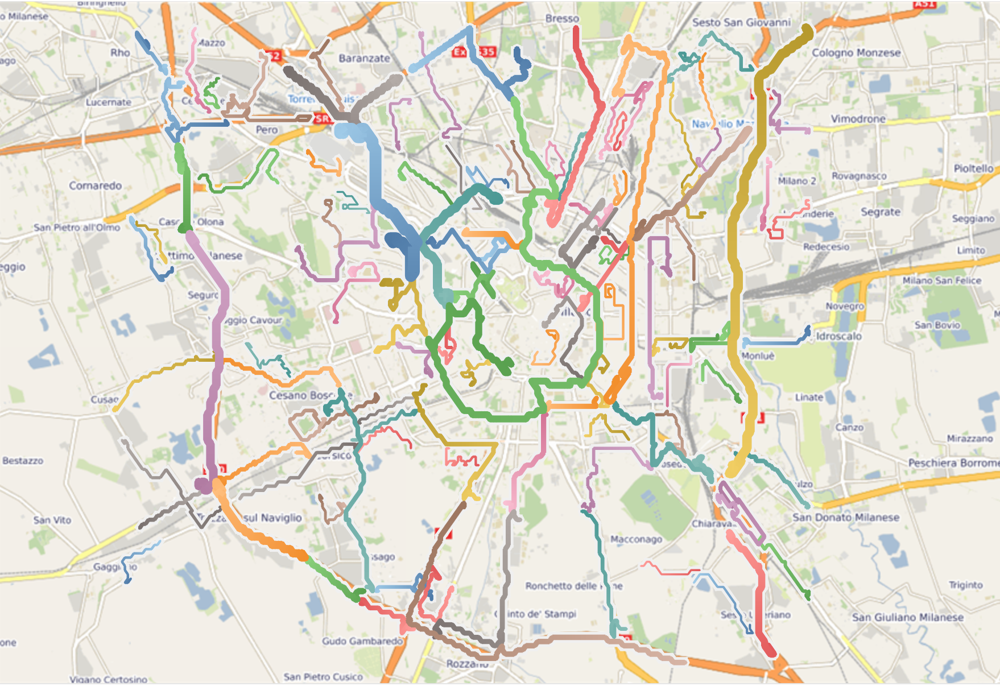
:::
::: {.column width="50%"}
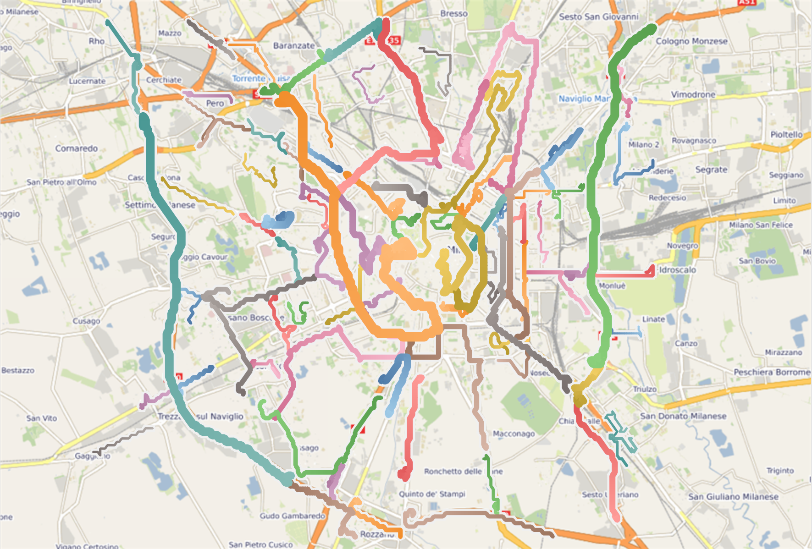
:::
::::

# Exploitation of Trajectory Data: Mobility optimization @ garbage collection paths for HERA

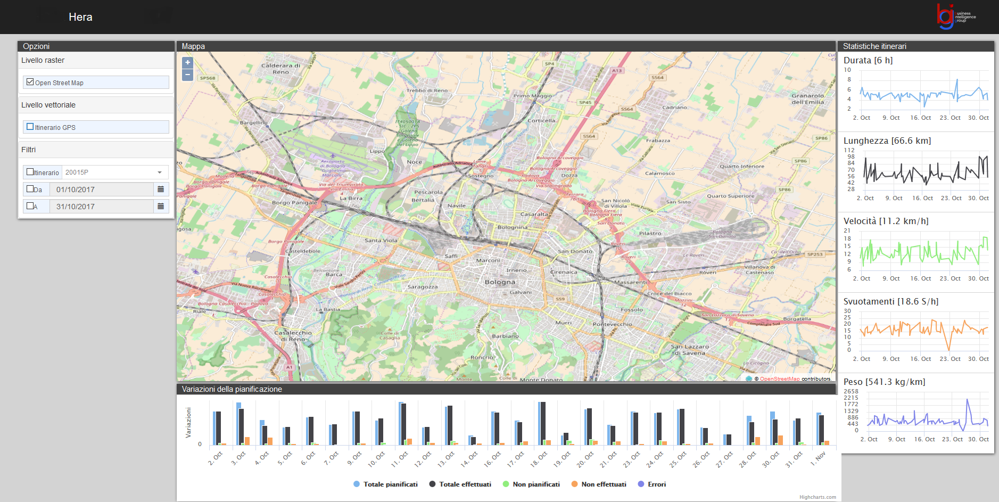

# Exploitation of Trajectory Data: Mobility optimization @ garbage collection paths for HERA

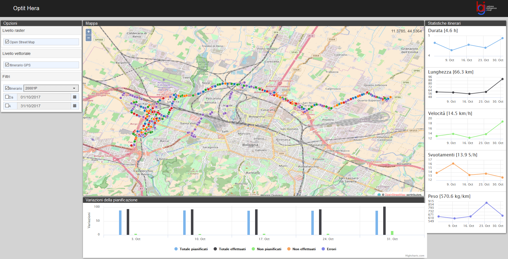

